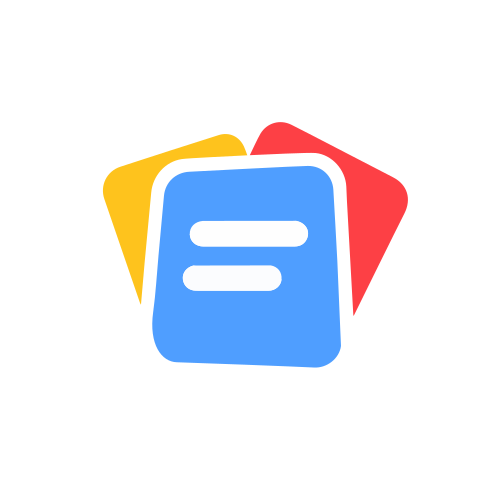
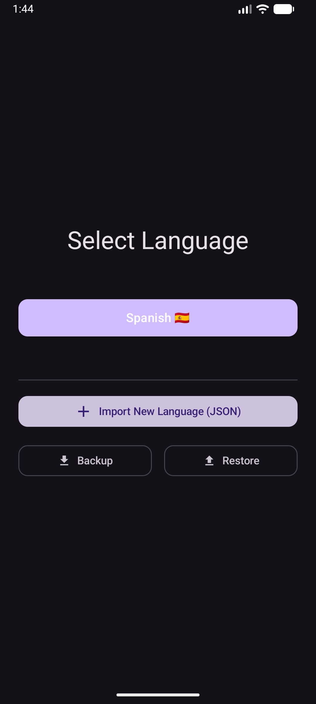
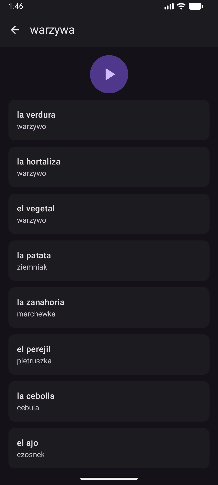
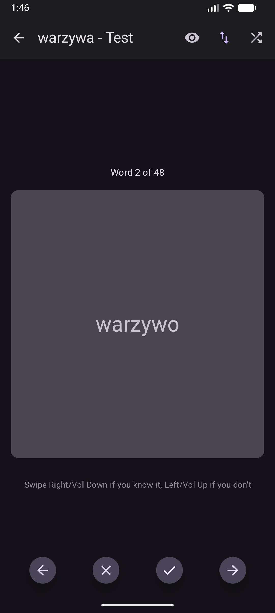
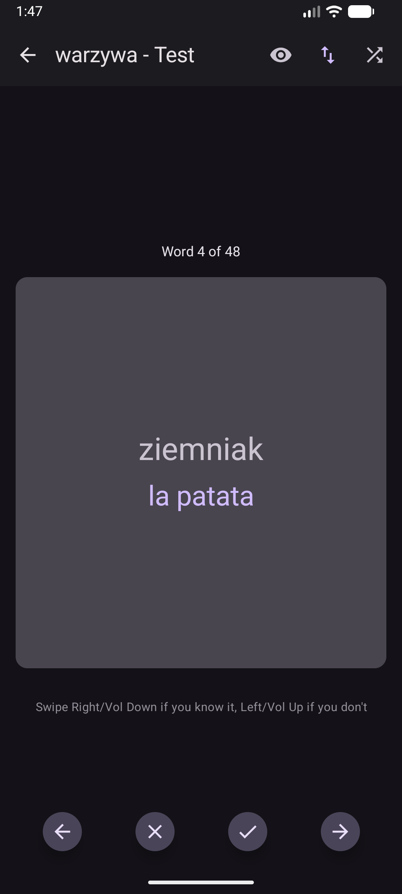
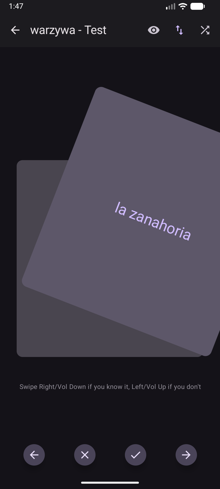
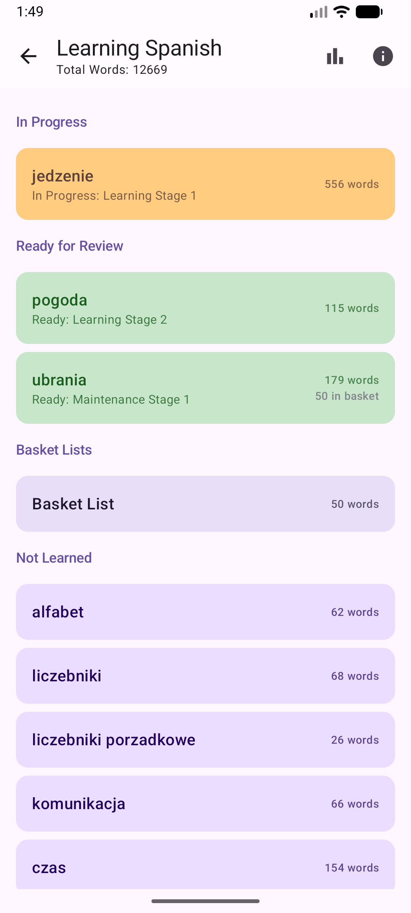

<p align="center">
  
</p>

<h1 align="center">Fiszki</h1>

An Android app for learning vocabulary with flashcards and spaced repetition. Learning material is organized by language, theme, and subtheme, with progress tracked separately for each part.

## Features

- Learn and test vocabulary without having to manage them manually.
- Rate answers with gestures: swipe right if you know a word, or left if you do not. During tests, the volume buttons can be used as well: volume down / volume up.
- Spaced-repetition schedule and a separate basket for difficult words.
- Large themes are divided into smaller batches.
- Import language data from JSON, export a full backup, and restore app data.
- Learning progress statistics.

## Screenshots

<table>
  <tr>
    <th>Language selection</th>
    <th>Vocabulary list</th>
    <th>Flashcard test</th>
  </tr>
  <tr>
    <td></td>
    <td></td>
    <td></td>
  </tr>
  <tr>
    <th>Answer revealed</th>
    <th>Card swipe animation</th>
    <th>Themes and basket progress</th>
  </tr>
  <tr>
    <td></td>
    <td></td>
    <td></td>
  </tr>
</table>

## Learning Algorithm

### Stages and Schedule

Each theme or batch has its own learning stage and next-available date. After a session is completed, the app advances the stage and schedules the next review using the following intervals:

| Current state | Next stage | Interval after completion |
| --- | --- | --- |
| Not started | Learning 1 | 1 day |
| Learning 1 | Learning 2 | 3 days |
| Learning 2 | Learning 3 | 7 days |
| Learning 3 | Learning 4 | 21 days |
| Learning 4 | Maintenance 1 | 1 month |
| Maintenance 1 | Maintenance 2 | 2 months |
| Maintenance 2 | Maintenance 3 | 3 months |
| Maintenance 3 | Completed | 3 months |
| Completed | Completed | 3 months |

The interval is counted from the day the session is completed. A review due on a given day becomes available at 05:30 local time.

The regular schedule belongs to each theme batch. In Learning 1–4, a failed test does not advance the stage; the learner can study and retry the missed words. The learner can also choose “Proceed anyway.” Maintenance 4 is the transition point: from this stage onward, a review can advance even when some words are missed, and those words are added to the basket.

### Basket

The basket is a second, independent review track, not a replacement for the regular theme schedule. A word stays associated with its original theme and batch, while its basket membership and basket learning status are tracked separately. Adding words to the basket therefore does not stop the theme batch from advancing.

Basket batches have their own progress and use the same interval configuration, but their cycle ends after Learning 4 instead of continuing into maintenance. A successful test advances the basket batch; if any words are missed, the batch stays at its current stage so those words can be retried. Once every word passes the Learning 3 test, the batch is cleared from the basket. Words can also be removed manually.

### Batching

Themes with many words are split into batches of 50. If the last theme batch contains fewer than 20 words, it is merged with the previous batch. Schedule progress is tracked separately for each batch.

Basket batches contain at most 50 words, even when the final basket has only one word. Removing a word pulls later words forward to fill the gap. Each remaining basket keeps its stage and review dates, and words that move forward join that basket's stage. Empty final baskets and their progress are removed. Completing an entire basket renumbers later baskets while preserving their progress.

## Import and Backups

Language import expects a JSON file with this structure:

```json
{
  "name": "es",
  "displayName": "Spanish",
  "flag": "🇪🇸",
  "themes": [
    {
      "name": "Czas",
      "words": [
        {
          "original": "el domingo",
          "translation": "niedziela",
          "subtheme": "dni tygodnia"
        },
      ]
    }
  ]
}
```

The `name`, `displayName`, and `flag` fields can also be provided inside a `language` object. The `subtheme` field is optional. Importing a language again replaces its themes and words; the app attempts to preserve progress and basket entries for matching themes and words.

A backup includes all languages, themes, words, statuses, and review progress. Restoring a backup replaces all local app data.

## Vocabulary Converter

[`scripts/vocabConverter.py`](scripts/vocabConverter.py) converts a Markdown vocabulary list into the JSON structure accepted by the app's language importer. It reads `vocab.md` from the current working directory and writes `vocab.json` there, so run it from the directory containing the input file:

```bash
cd scripts
python vocabConverter.py
```

The Markdown format uses bold level-2 headings for themes, bold level-3 headings for subthemes, and one escaped hyphen between each word and translation:

```markdown
## **czas**
### **dni tygodnia**
el sábado \- sobota  
el domingo \- niedziela
```

Words are assigned to the current theme and subtheme. If no subtheme heading is provided, the theme name is used as the subtheme. Empty themes are omitted from the output. The generated JSON has empty `name`, `displayName`, and `flag` fields; fill these in before importing it into the app.

## Technology

- Kotlin and Android SDK; `minSdk 26`, `compileSdk` / `targetSdk 37`.
- Jetpack Compose and Material 3 for the UI.
- `ViewModel`, Kotlin Coroutines, and `StateFlow` for state management and asynchronous work.
- Room with SQLite for local storage of languages, themes, words, and progress. Changes spanning multiple tables are performed in transactions.
- Kotlin Serialization for JSON import and export.
- KSP for Room code generation.

The app uses a single activity. `MainActivity` connects the screens and handles import and backup flows, `MainViewModel` manages app state and logic, and repositories and DAOs separate data access from the UI.

## Build

JDK 21 and Android SDK Platform 37 are required. From the project root, run:

```bash
./gradlew assembleDebug
```

The debug APK is written to `app/build/outputs/apk/debug/`. Run unit tests with:

```bash
./gradlew test
```
